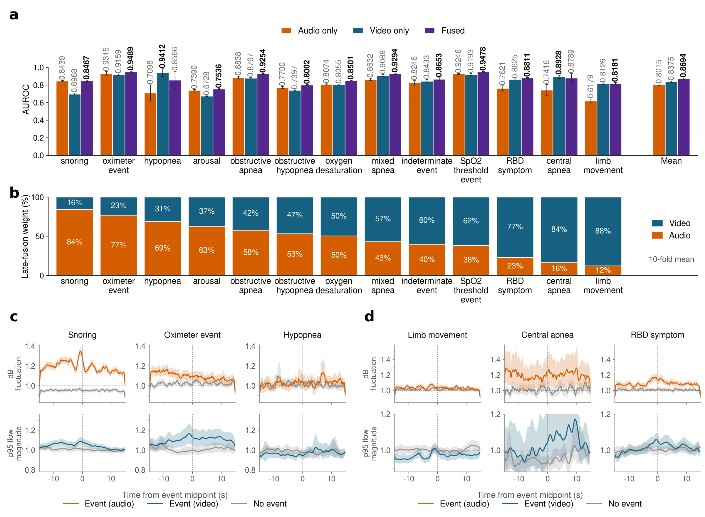
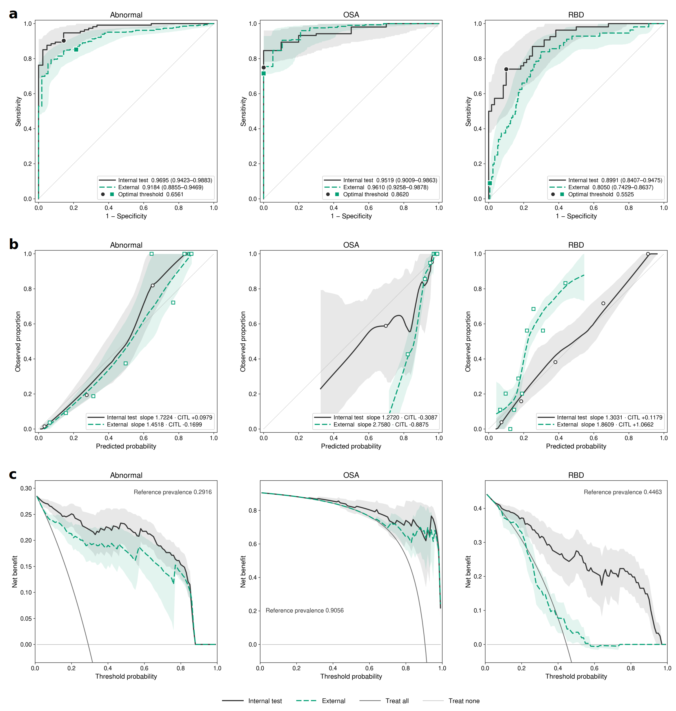
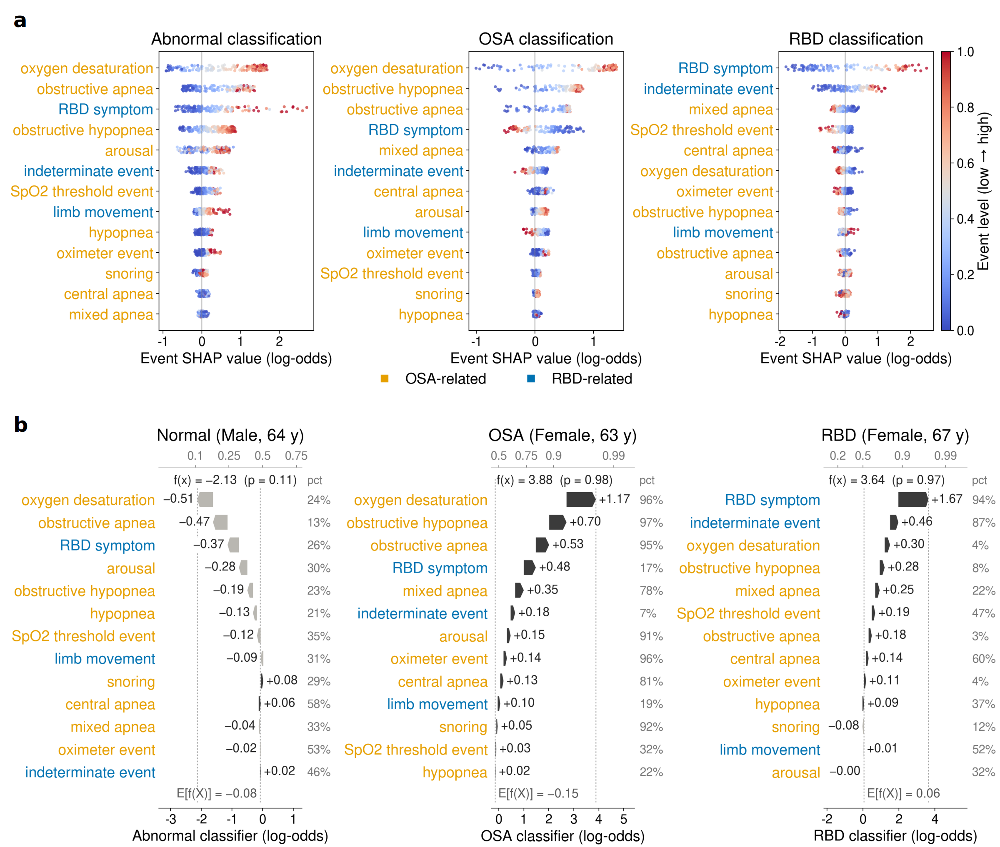
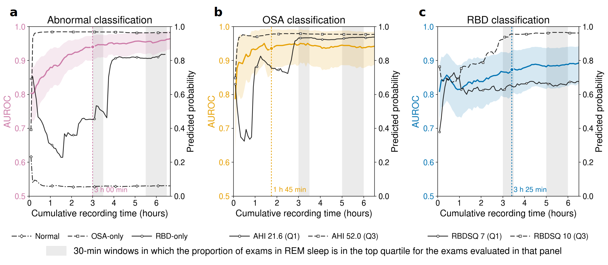

<div align="center">

# Contactless audiovisual screening for obstructive sleep apnea and REM sleep behavior disorder from overnight recordings

Jin Yong Kim<sup>1,†</sup>, Bo Kyu Choi<sup>2,†</sup>, Jungyon Yum<sup>3</sup>, Doyeon Kook<sup>2</sup>, Joonho Kim<sup>4</sup>,
Soomi Cho<sup>4</sup>, Woo-Seok Ha<sup>4</sup>, Wonwoo Lee<sup>3</sup>, Min Kyung Chu<sup>4</sup>, Won-Joo Kim<sup>2</sup>,
Kyung Min Kim<sup>4,\*</sup>, Yu Rang Park<sup>1,\*</sup>

<sup>1</sup>Department of Biomedical Systems Informatics, Yonsei University College of Medicine, Seoul, Republic of Korea<br>
<sup>2</sup>Department of Neurology, Gangnam Severance Hospital, Yonsei University College of Medicine, Seoul, Republic of Korea<br>
<sup>3</sup>Department of Neurology, Yongin Severance Hospital, Yonsei University College of Medicine, Yongin, Republic of Korea<br>
<sup>4</sup>Department of Neurology, Severance Hospital, Yonsei University College of Medicine, Seoul, Republic of Korea<br>
<sup>†</sup>Equal contribution &nbsp;·&nbsp; <sup>\*</sup>Co-corresponding authors

[](LICENSE)


</div>

Analysis code of a two-stage framework that screens for **obstructive sleep apnea (OSA)** and **REM sleep behavior
disorder (RBD)** from the **video and audio** of an overnight polysomnography (PSG) recording, without
body-attached sensors.

1. **Sleep-event detection.** Two Vision Transformers, one on the optical flow of the infrared video and one on the
   log-Mel spectrogram of the audio, score every 30-second window for 13 PSG-annotated sleep events; their outputs
   are fused per event.
2. **Disorder classification.** The event probabilities are summarised over the night, and XGBoost classifiers
   detect abnormal sleep, OSA and RBD. SHAP values explain each prediction through the sleep events.

The models were developed on 1,402 patients from two hospitals (nested 10-fold cross-validation), tested on 156
held-out patients from the same hospitals and validated on 402 patients from a third hospital.

## Results

| AUROC (95 % CI) | Internal test | External validation |
|---|---|---|
| Abnormal sleep (OSA and/or RBD) vs normal | 0.9695 (0.9423–0.9883) | 0.9184 (0.8855–0.9469) |
| OSA | 0.9519 (0.9009–0.9863) | 0.9610 (0.9258–0.9878) |
| RBD | 0.8991 (0.8407–0.9475) | 0.8050 (0.7429–0.8637) |

OSA and RBD are classified among patients with abnormal sleep (internal 114 of 156, external 346 of 402).

<p align="center"></p>

**Event detection.** Window-level AUROC of the audio-only, video-only and fused detectors (a), late-fusion weights
(b) and event-locked audio and video signals (c, d). Fusion raised the mean AUROC over the 13 events from 0.8015
(audio) and 0.8375 (video) to 0.8694.

<p align="center"></p>

**Disorder detection.** ROC curves (a), calibration (b) and decision curves (c) on the internal test and external
validation sets.

<p align="center"></p>

**Interpretability.** Event-level SHAP values of the three classifiers (a) and three patient-level examples (b).

<p align="center"></p>

**Recording time.** AUROC as the recording is extended in 5-minute steps. Performance was non-inferior to the full
night after 1 h 45 min for OSA, 3 h 00 min for abnormal sleep and 3 h 25 min for RBD.

> [!NOTE]
> The framework is a screening aid and does not replace diagnostic PSG. RBD discrimination is lower at the external
> hospital; probabilities and thresholds should be recalibrated before use at a new site.

## Repository

```
psgscreen/
├── preprocessing/    recordings → optical flow, motion records, log-Mel spectrogram; scoring-export parsers
├── cohort/           PSG report parsing, cohort, labels and splits, Table 1
├── dataset/          30-s windows, ViT input arrays, hypnogram, event-locked traces
├── model/            ViT detectors, late fusion, exam features, disorder and severity classifiers, SHAP
├── evaluation/       detection, disorder and clinical metrics, model comparisons, supplementary tables
└── figures/          main and supplementary figures
configs/              selected hyper-parameters
scripts/run_all.sh    every step in execution order
environment/          Python environments and package versions
```

## Usage

Patient data (videos, audio, PSG reports, scoring exports) and trained weights are not included.

```bash
export PSG_DATA=/path/to/data      # inputs (see "Input files" below)
export PSG_WORK=/path/to/work      # everything the code writes
PY=… PYB=… PYP=… PYF=… PYFC=… PYV=… bash scripts/run_all.sh
```

The six interpreters (`PY` … `PYV`) and their package versions are described in
[`environment/ENVIRONMENTS.md`](environment/ENVIRONMENTS.md). Each step can also be run on its own with its command
from `scripts/run_all.sh`, e.g. `python -m psgscreen.model.disorder`; `-h` lists the options of every module.

<details>
<summary>Input files</summary>

| `PSG_DATA/…` | Content |
|---|---|
| `video/<centre>/…/<exam folder>/*.avi` | PSG video files of an exam (the folder name contains the exam uuid) |
| `annotation_exports/<centre>/` | Scoring exports: NeuroWorks `.txt` (Hospitals A and B), Xltek `.ent` / `.erd` (Hospital C) |
| `reports/<centre>/` | PSG report files (`.doc` / `.docx`) |
| `cohort/exam_inventory.csv` | `uuid, exam_id, center, exam_date, exam_month`: exams with synchronized video and audio |
| `cohort/exclusions.csv` | `uuid, reason`: failed quality review, PAP-treated or split-night studies |
| `cohort/splits.csv` | `uuid, split, fold`: internal test (`test`) or development (`dev`, folds 0–9) |
| `cohort/yi_questionnaires/` | Hospital C questionnaire exports for RBDSQ scores missing from the report |

Centre codes: `SC` = Hospital A, `GN` = Hospital B, `YI` = Hospital C.

</details>

<details>
<summary>Figures and tables → code</summary>

| Item | Module |
|---|---|
| Figure 3, event detection | `figures.event_detection` |
| Figure 4, ROC, calibration and decision curves | `figures.disorder_detection` |
| Figure 5, SHAP | `figures.shap` |
| Figure 6, cumulative recording time | `figures.time_course` |
| Table 1 | `cohort.table1` |
| Supplementary Figures S1, S2, S3 | `figures.disorder_detection --severity`, `figures.severity_shap`, `figures.group_probability` |
| Supplementary Tables S3, S4, S5–S6 | `evaluation.supp_tables operating`, `… fusion`, `… alt` |

Figures 1 and 2 and Supplementary Tables S1 and S2 were made by hand.

</details>

## Citation

Citation details will be added on publication.

## License

MIT; see [`LICENSE`](LICENSE).
